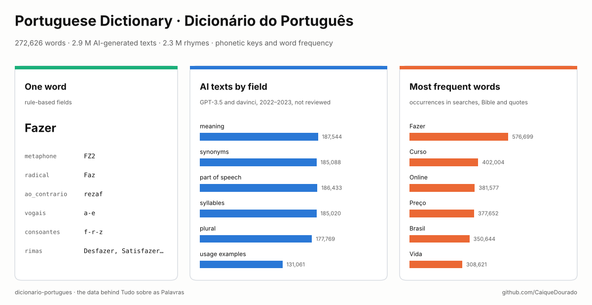
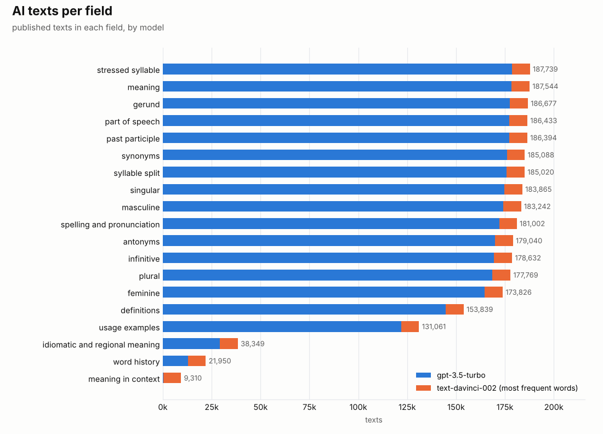
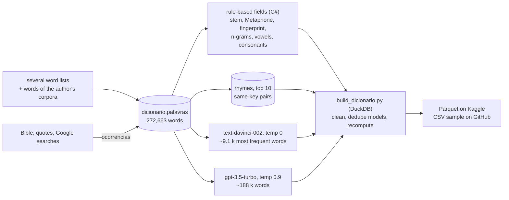

# Portuguese Dictionary · Dicionário do Português

[](https://github.com/CaiqueDourado/dicionario-portugues/actions/workflows/validate.yml)
[](LICENSE-DATA.md)
[](LICENSE)
[](https://www.kaggle.com/datasets/caiquedourado/dicionario-portugues)
[](https://www.kaggle.com/code/caiquedourado/notebook-dicionario-portugues)

[Leia em português](README.pt-BR.md)



A Brazilian Portuguese word list of **272,626 words**, each with **rule-based fields** (word without accents,
stem, reversed word, vowels, consonants, last characters, number of letters, Metaphone and fingerprint keys) and how
often it appears in the author's corpora, plus **2,916,780 texts generated by AI** for 187,949 of them: meaning,
definitions, synonyms, antonyms, part of speech, syllables, stressed syllable, plural, feminine, gerund, participle…
It also has **2,287,766 rhymes** and **11,868,060 pairs of words that share a key**.

> **The AI texts were not reviewed.** They were generated in 2022–2023 by `text-davinci-002` and `gpt-3.5-turbo`
> and contain mistakes: *"Fazer significa fazer algo"*, *Curso* as a proper noun, *Brasils* as a plural.
> Use them as a starting point, as training or evaluation data for language tools, or to study what those
> models got wrong, not as an authority on Portuguese.

It is the data behind **Tudo sobre as Palavras**, a dictionary site the author ran, one page per word.

## What is inside

| File | Rows | What |
|---|---:|---|
| `palavras-*.parquet` | 272,626 | one word per row: rule-based fields, `ocorrencias`, and the 19 AI text fields (the `gpt-3.5-turbo` text when there is one, otherwise the `text-davinci-002` text) |
| `textos_ia-*.parquet` | 2,916,780 | every AI text with its model: `id_palavra`, `campo`, `modelo`, `texto` |
| `rimas-*.parquet` | 2,287,766 | `palavra`, `rima`: up to 10 rhymes per word (same last characters) |
| `mesmo_fingerprint-*.parquet` | 11,868,060 | `palavra`, `outra`: words with the same normalized key, mostly inflections (*Fazer* → *Fazendo*, *Fazem*) |
| `stats.json` | | totals and every cleaning count |

The full data (11 Parquet files) is on [Kaggle](https://www.kaggle.com/datasets/caiquedourado/dicionario-portugues);
[`sample/`](sample) has the 1,000 most frequent words, their AI texts, and samples of rhymes and pairs as CSV.

## How a word is structured


The most frequent word, *Fazer*, with 16 of its 36 fields and the texts cut. The rule-based fields are reliable;
the AI texts show the problem in this very word: the "feminine" of a verb. Full file:
[docs/palavra-fazer.json](docs/palavra-fazer.json).

## The site this comes from


**Tudo sobre as Palavras** had one page per word with the fields of this dataset in the left menu: meaning,
definitions, synonyms, antonyms, spelling and pronunciation, part of speech, consonants, vowels, reversed word,
stem, syllables, stressed syllable, singular, feminine, masculine, infinitive, gerund, past participle, number of
letters, activities, similar words and rhymes, plus a short video per word. It had about 187 thousand pages, one
per word with AI texts, generated as static HTML in C# from SQL Server and hosted on Google Cloud Storage (2023).
The page above is *Arrogado*, kept in the
[Web Archive](https://web.archive.org/web/20250923215535/https://tudosobreaspalavras.com/tudo-sobre-a-palavra-arrogado).

## What the data shows



- **Two models.** `text-davinci-002` (temperature 0) wrote the texts of the **~9,100 most frequent words**
  (`ocorrencias` above 1,000); `gpt-3.5-turbo` (temperature 0.9) wrote most of the rest. In the source table the
  davinci columns held copies of the ChatGPT text for 2,754,358 cells; those copies were removed, so each text
  appears once, with its real model.
- **Uneven fields.** 16 fields cover 130–188 thousand words; history of the word, idiomatic meaning and meaning in
  context were only asked for a few thousand.
- **Typical mistakes**, kept as written: definitions that repeat the word, "proper noun" for common nouns, letters
  split one by one (*C-U-R-S-O*), English answers (*Noun*, the idiomatic meaning of *Fazer*), plurals of invariable
  words (*Ondes*), "feminine" of verbs. Among the 1,000 most frequent words, the part of speech is "proper noun" for
  274 and an English answer for 215 (see the [notebook](notebooks/estudo.ipynb)).

## Use it

```python
import duckdb

p = "palavras-*.parquet"          # on Kaggle: /kaggle/input/dicionario-portugues/palavras-*.parquet
duckdb.sql(f"""
    SELECT palavra, ocorrencias, classe_gramatical, significado FROM '{p}'
    WHERE palavra ILIKE 'casa%' ORDER BY ocorrencias DESC LIMIT 10""").show()

# words that sound like "casa" (same Metaphone key)
duckdb.sql(f"SELECT palavra FROM '{p}' WHERE metaphone = (SELECT metaphone FROM '{p}' WHERE palavra = 'Casa')").show()

# rhymes for a poem
duckdb.sql("SELECT rima FROM 'rimas-*.parquet' WHERE palavra = 'Amor'").show()
```

The [notebook](notebooks/estudo.ipynb) has more queries.

## How it was made



- **The word list** was compiled from several word lists and from the words of the author's own corpora. Each word
  was capitalized (*Fazer*). `ocorrencias` counts how often the word appears in the Bible, in a quotes collection and
  in Google searches with volume; 109,230 words appear at least once.
- **Rule-based fields** were computed by the author's C# code. `palavra_sem_acento`, `ao_contrario` and
  `numero_letras` were recomputed in the build: the old code turned *ss* into *B* in 28,046 words
  (*ProclamaBes*). The others are published as computed; words with a hyphen got odd keys (*Online* → fingerprint
  `line`).
- **AI texts.** One prompt per field per word, 20 fields, saved as returned. The build
  ([scripts/build_dicionario.py](scripts/build_dicionario.py)):
  - removed the 2,754,358 davinci cells that were copies of the ChatGPT text;
  - trimmed leading spaces and line breaks;
  - cut 5,883 echoes of the prompt ("com pelo menos 10 exemplos.") and 45,686 phonetic transcriptions lost in an old
    encoding conversion (`/?n'la?n/`);
  - dropped 1,280 texts where the model talks about itself ("como uma IA") and 6,330 with characters lost mid-word
    (*pron?ncia*);
  - left out 37 words marked as ignored.
- **Activities** (`exerciciosJogos`) are not here: they will be a dataset of their own.
- **Exports** ([scripts/exportar_dicionario.py](scripts/exportar_dicionario.py)) read each SQL Server table once into
  Parquet; every check runs on the Parquet with DuckDB.

## Limits

- The AI texts were not reviewed (see the warning above) and some cells still carry prompt echoes in the middle of
  the text ("com exemplos.").
- The word list mixes Brazilian Portuguese with inflections, names, loanwords and a few typos.
- `ocorrencias` reflects the author's corpora, not Portuguese in general.
- Rhymes are by spelling, not sound; same-key pairs include unrelated words (*Severo* → *Sovara*).

## Related

- [portuguese-entity-gazetteer](https://github.com/CaiqueDourado/portuguese-entity-gazetteer): 307 thousand entities (places, people, works, products) with their types, the proper-name side.
- [search-pattern-miner](https://github.com/CaiqueDourado/search-pattern-miner): the same Lucene stemmer and stopwords turn searches into patterns.
- [palavras-da-biblia](https://github.com/CaiqueDourado/palavras-da-biblia): the Bible word counts behind part of `ocorrencias`.
- [google-keywords-dataset](https://github.com/CaiqueDourado/google-keywords-dataset): the Google searches behind part of `ocorrencias`.
- [brazilian-names-surnames](https://github.com/CaiqueDourado/brazilian-names-surnames): names with the same phonetic keys.
- [DedupKit](https://github.com/CaiqueDourado/DedupKit): phonetic keys and matching for Portuguese.
- [PtBr.Text](https://github.com/CaiqueDourado/PtBr.Text): Portuguese text tools for .NET.

## License

The compilation, the rule-based fields, the counts, the rhymes, the pairs and the AI texts are
[CC BY 4.0](LICENSE-DATA.md). Code: [MIT](LICENSE). Removal requests: open an issue.

## Author

**Caique Dourado**: 20 years building crawlers, data pipelines and programmatic SEO in .NET and SQL Server. More at [github.com/CaiqueDourado](https://github.com/CaiqueDourado).
