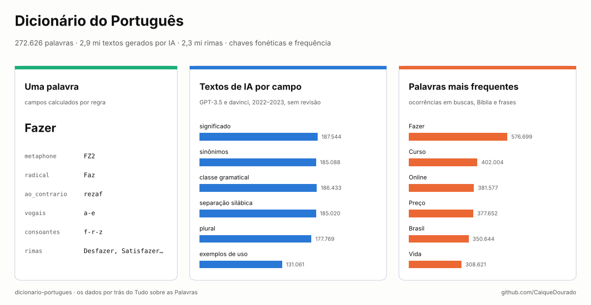
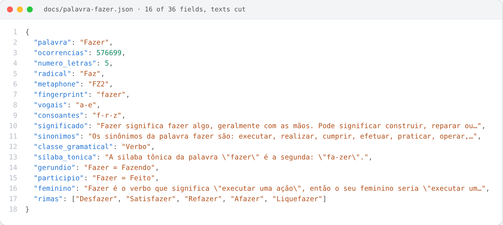
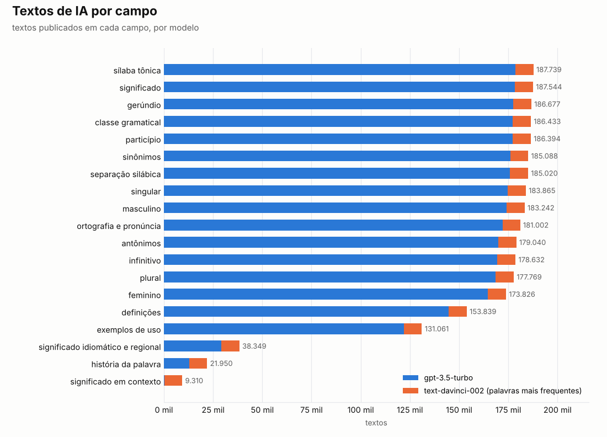
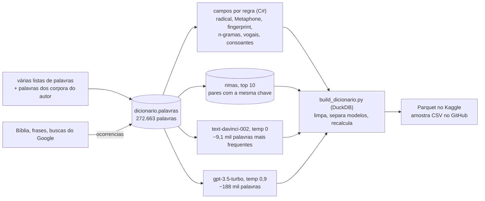

# Dicionário do Português

[](https://github.com/CaiqueDourado/dicionario-portugues/actions/workflows/validate.yml)
[](LICENSE-DATA.md)
[](LICENSE)
[](https://www.kaggle.com/datasets/caiquedourado/dicionario-portugues)
[](https://www.kaggle.com/code/caiquedourado/notebook-dicionario-portugues)

[Read in English](README.md)



Uma lista de **272.626 palavras** do português do Brasil, cada uma com **campos calculados por regra** (palavra sem
acento, radical, palavra ao contrário, vogais, consoantes, últimos caracteres, número de letras, chaves Metaphone e
fingerprint) e quantas vezes aparece nos corpora do autor, mais **2.916.780 textos gerados por IA** para 187.949
delas: significado, definições, sinônimos, antônimos, classe gramatical, separação silábica, sílaba tônica, plural,
feminino, gerúndio, particípio… Traz também **2.287.766 rimas** e **11.868.060 pares de palavras com a mesma chave**.

> **Os textos de IA não foram revisados.** Foram gerados em 2022–2023 pelos modelos `text-davinci-002` e
> `gpt-3.5-turbo` e têm erros: *"Fazer significa fazer algo"*, *Curso* como nome próprio, *Brasils* como plural.
> Use como ponto de partida, como dado de treino ou de avaliação para ferramentas de linguagem, ou para estudar o que
> esses modelos erravam, não como referência do português.

São os dados por trás do **Tudo sobre as Palavras**, um site de dicionário do autor, com uma página por palavra.

## O que tem

| Arquivo | Linhas | O quê |
|---|---:|---|
| `palavras-*.parquet` | 272.626 | uma palavra por linha: campos por regra, `ocorrencias` e os 19 campos de texto de IA (o texto do `gpt-3.5-turbo` quando existe; senão, o do `text-davinci-002`) |
| `textos_ia-*.parquet` | 2.916.780 | todos os textos de IA com o modelo: `id_palavra`, `campo`, `modelo`, `texto` |
| `rimas-*.parquet` | 2.287.766 | `palavra`, `rima`: até 10 rimas por palavra (mesmos últimos caracteres) |
| `mesmo_fingerprint-*.parquet` | 11.868.060 | `palavra`, `outra`: palavras com a mesma chave normalizada, quase sempre flexões (*Fazer* → *Fazendo*, *Fazem*) |
| `stats.json` | | totais e todas as contagens da limpeza |

Os dados completos (11 arquivos Parquet) estão no [Kaggle](https://www.kaggle.com/datasets/caiquedourado/dicionario-portugues);
a pasta [`sample/`](sample) tem as 1.000 palavras mais frequentes, os textos de IA delas e amostras de rimas e pares em CSV.

## Como uma palavra é estruturada



A palavra mais frequente, *Fazer*, com 16 dos seus 36 campos e os textos cortados. Os campos por regra são
confiáveis; os textos de IA mostram o problema na própria palavra: o "feminino" de um verbo. Arquivo completo:
[docs/palavra-fazer.json](docs/palavra-fazer.json).

## O site de onde isto vem


O **Tudo sobre as Palavras** tinha uma página por palavra com os campos deste dataset no menu da esquerda:
significado, definições, sinônimos, antônimos, ortografia e pronúncia, classe gramatical, consoantes, vogais, ao
contrário, radical, separação silábica, sílaba tônica, singular, feminino, masculino, infinitivo, gerúndio,
particípio passado, número de letras, atividades, palavras semelhantes e rimas, além de um vídeo curto por palavra.
Eram cerca de 187 mil páginas, uma por palavra com textos de IA, geradas em HTML estático com C# a partir do SQL
Server e hospedadas no Google Cloud Storage (2023). A página acima é *Arrogado*, guardada no
[Web Archive](https://web.archive.org/web/20250923215535/https://tudosobreaspalavras.com/tudo-sobre-a-palavra-arrogado).

## O que os dados mostram



- **Dois modelos.** O `text-davinci-002` (temperatura 0) escreveu os textos das **~9.100 palavras mais frequentes**
  (`ocorrencias` acima de 1.000); o `gpt-3.5-turbo` (temperatura 0,9) escreveu quase todo o resto. Na tabela de
  origem, as colunas do davinci guardavam cópias do texto do ChatGPT em 2.754.358 células; essas cópias saíram, então
  cada texto aparece uma vez, com o modelo que de fato o escreveu.
- **Campos desiguais.** 16 campos cobrem de 130 a 188 mil palavras; história da palavra, significado idiomático e
  significado em contexto foram pedidos só para alguns milhares.
- **Erros típicos**, mantidos como vieram: definições que repetem a palavra, "nome próprio" para substantivos comuns,
  letras separadas uma a uma (*C-U-R-S-O*), respostas em inglês (*Noun*, o significado idiomático de *Fazer*), plural
  de palavras invariáveis (*Ondes*), "feminino" de verbos. Entre as 1.000 palavras mais frequentes, a classe gramatical
  é "nome próprio" em 274 e vem em inglês em 215 (veja o [notebook](notebooks/estudo.ipynb)).

## Como usar

```python
import duckdb

p = "palavras-*.parquet"          # no Kaggle: /kaggle/input/dicionario-portugues/palavras-*.parquet
duckdb.sql(f"""
    SELECT palavra, ocorrencias, classe_gramatical, significado FROM '{p}'
    WHERE palavra ILIKE 'casa%' ORDER BY ocorrencias DESC LIMIT 10""").show()

# palavras que soam como "casa" (mesma chave Metaphone)
duckdb.sql(f"SELECT palavra FROM '{p}' WHERE metaphone = (SELECT metaphone FROM '{p}' WHERE palavra = 'Casa')").show()

# rimas para um poema
duckdb.sql("SELECT rima FROM 'rimas-*.parquet' WHERE palavra = 'Amor'").show()
```

O [notebook](notebooks/estudo.ipynb) tem mais consultas.

## Como foi feito



- **A lista de palavras** foi compilada de várias listas de palavras e das palavras dos corpora do próprio autor.
  Cada palavra está com inicial maiúscula (*Fazer*). `ocorrencias` conta quantas vezes a palavra aparece na Bíblia,
  numa coleção de frases e em buscas do Google com volume; 109.230 palavras aparecem pelo menos uma vez.
- **Campos por regra** foram calculados pelo código C# do autor. `palavra_sem_acento`, `ao_contrario` e
  `numero_letras` foram recalculados no build: o código antigo trocava *ss* por *B* em 28.046 palavras
  (*ProclamaBes*). Os demais saem como foram calculados; palavras com hífen ganharam chaves estranhas (*Online* →
  fingerprint `line`).
- **Textos de IA.** Um prompt por campo por palavra, 20 campos, gravados como vieram. O build
  ([scripts/build_dicionario.py](scripts/build_dicionario.py)):
  - tirou as 2.754.358 células do davinci que eram cópia do texto do ChatGPT;
  - tirou espaços e quebras de linha do começo e do fim;
  - cortou 5.883 ecos do prompt ("com pelo menos 10 exemplos.") e 45.686 transcrições fonéticas perdidas numa
    conversão antiga de codificação (`/?n'la?n/`);
  - descartou 1.280 textos em que o modelo fala de si ("como uma IA") e 6.330 com caracteres perdidos no meio da
    palavra (*pron?ncia*);
  - deixou de fora 37 palavras marcadas como ignoradas.
- **Atividades** (`exerciciosJogos`) não estão aqui: vão virar um dataset próprio.
- **Exportação** ([scripts/exportar_dicionario.py](scripts/exportar_dicionario.py)): cada tabela do SQL Server é lida
  uma vez para Parquet; todas as conferências rodam no Parquet com DuckDB.

## Limites

- Os textos de IA não foram revisados (veja o aviso acima) e algumas células ainda têm ecos do prompt no meio do texto
  ("com exemplos.").
- A lista mistura português do Brasil com flexões, nomes, estrangeirismos e alguns erros de digitação.
- `ocorrencias` reflete os corpora do autor, não o português em geral.
- As rimas são pela grafia, não pelo som; os pares com a mesma chave incluem palavras sem relação (*Severo* → *Sovara*).

## Relacionados

- [palavras-da-biblia](https://github.com/CaiqueDourado/palavras-da-biblia): as contagens da Bíblia por trás de parte de `ocorrencias`.
- [google-keywords-dataset](https://github.com/CaiqueDourado/google-keywords-dataset): as buscas do Google por trás de parte de `ocorrencias`.
- [brazilian-names-surnames](https://github.com/CaiqueDourado/brazilian-names-surnames): nomes com as mesmas chaves fonéticas.
- [DedupKit](https://github.com/CaiqueDourado/DedupKit): chaves fonéticas e matching para o português.
- [PtBr.Text](https://github.com/CaiqueDourado/PtBr.Text): ferramentas de texto em português para .NET.

## Licença

A compilação, os campos por regra, as contagens, as rimas, os pares e os textos de IA estão sob
[CC BY 4.0](LICENSE-DATA.md). Código: [MIT](LICENSE). Pedidos de remoção: abra uma issue.

## Autor

**Caique Dourado**: 20 anos construindo crawlers, pipelines de dados e SEO programático em .NET e SQL Server. Mais em [github.com/CaiqueDourado](https://github.com/CaiqueDourado).
